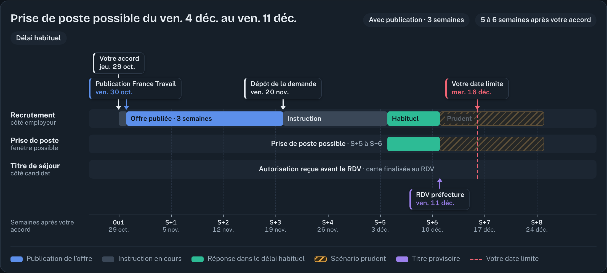
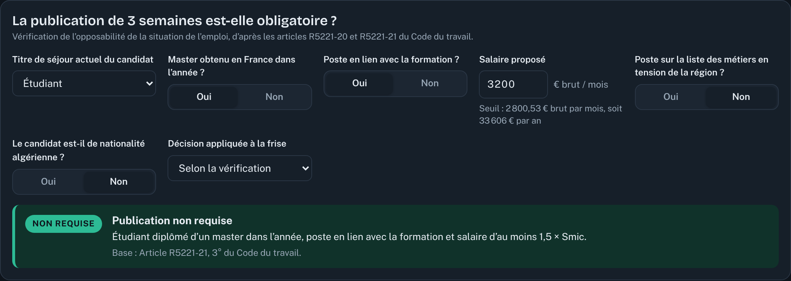
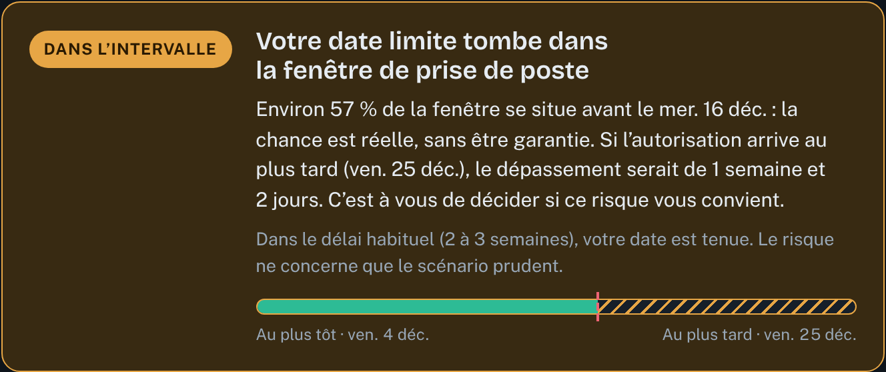

# Calendrier de prise de poste

Simulateur open source pour estimer, avec un recruteur, la date à laquelle un candidat étranger peut commencer quand une **autorisation de travail** est nécessaire.

**Faire la simulation : https://anishacini12.github.io/calendrier-prise-de-poste/**

📄 [Guide d’utilisation (PDF)](docs/guide-calendrier-prise-de-poste.pdf)

## Pourquoi

Un candidat qui a besoin d’une autorisation de travail ne peut pas commencer le lendemain de l’accord. Entre la publication de l’offre, le dépôt de la demande et la réponse de l’administration, il faut compter plusieurs semaines. En entretien, ce délai est souvent expliqué à l’oral, sans dates, et il inquiète plus qu’il ne rassure.

Le simulateur remplace cette explication par une frise datée, lisible en deux minutes par le candidat et par le recruteur.

## Ce que fait l’outil

- **Place chaque étape sur une frise** : publication de l’offre sur France Travail, dépôt de la demande, instruction, titre provisoire, prise de poste.
- **Vérifie si la publication de 3 semaines est obligatoire** selon le titre de séjour, le diplôme, le salaire, le poste et la nationalité.
- **Calcule la fenêtre de prise de poste** en délai habituel (2 à 3 semaines d’instruction) ou en scénario prudent (jusqu’à 5 semaines).
- **Compare cette fenêtre à la date limite du recruteur** et rend un verdict : compatible, dans l’intervalle ou dépassement.

## Utilisation

1. **Renseigner les dates** : date de la réponse positive, date de prise de poste au plus tard, rendez-vous préfecture.
2. **Répondre aux questions** de « La publication de 3 semaines est-elle obligatoire ? ».
3. **Lire la frise** : les flèches montrent les dates clés, les couleurs les étapes, la ligne rouge la date limite.
4. **Lire le verdict**, puis basculer entre « Habituel » et « Prudent ».

Les durées et le seuil de salaire se règlent dans « Ajuster les durées et le seuil de salaire ».

## Règles de publication appliquées

| Situation du candidat | Publication de 3 semaines |
|---|---|
| Poste sur la liste des métiers en tension de la région, candidat non algérien | Non requise |
| Poste sur la liste des métiers en tension, candidat algérien (accord franco-algérien de 1968) | Requise |
| Étudiant avec un master obtenu en France dans l’année, poste en lien avec la formation, salaire ≥ 2 800,53 € brut/mois (1,5 × Smic) | Non requise (non garanti pour un candidat algérien) |
| Carte « recherche d’emploi ou création d’entreprise », poste en lien, même seuil de salaire | Non requise (carte non accessible aux Algériens) |
| Titre « salarié », changement d’employeur | Non requise, à confirmer |
| Tous les autres cas, dont le titre étudiant seul | Requise |

Les cas incertains sont signalés « À confirmer » dans l’outil. Le menu « Décision appliquée à la frise » permet de forcer le résultat.

## Limites

- Ce n’est **pas un avis juridique** : l’outil résume les textes consultés le 9 octobre 2026.
- Les délais d’instruction sont indicatifs et varient selon le service instructeur.
- Le pourcentage « dans l’intervalle » suppose que la réponse peut arriver n’importe quel jour de la fenêtre.

## Sources officielles

- [Salarié étranger : comment sont délivrées les autorisations de travail ?](https://www.service-public.gouv.fr/particuliers/vosdroits/F3100) (Service-public.fr, vérifié le 18 juin 2026)
- [Code du travail, article R5221-21](https://code.travail.gouv.fr/code-du-travail/r5221-21) (Code du travail numérique)
- [Liste des métiers en tension pour les travailleurs étrangers](https://www.immigration.interieur.gouv.fr/limmigration-en-france/sejour-des-etrangers/liste-des-metiers-en-tension-pour-travailleurs-etrangers) (Ministère de l’Intérieur)
- [Arrêté du 21 mai 2025 relatif aux métiers en tension](https://www.legifrance.gouv.fr/jorf/id/JORFTEXT000051643488) (Légifrance)
- [Étudiant algérien en France](https://www.service-public.gouv.fr/particuliers/vosdroits/F2215) (Service-public.fr)

Autres références : [note pratique « Changement de statut » du Gisti](https://www.infomie.net/IMG/pdf/np_2019-07_changement_de_statut.pdf), [Exilae sur le changement d’employeur](https://exilae.fr/le-changement-demployeur-pour-un-salarie-etranger-en-2021/).

## Lancer en local

Un seul fichier, sans dépendance ni compilation : téléchargez `index.html` et ouvrez-le dans un navigateur. Aucune donnée n’est envoyée ; les dates saisies restent dans votre navigateur.

## Contribuer

Les contributions sont bienvenues : règles d’autres nationalités soumises à des accords bilatéraux, cas particuliers, corrections de textes, traductions. Ouvrez une *issue* avec la source officielle qui justifie la modification.

## Licence

[MIT](LICENSE) © 2026 Anis Hacini

---

**English summary.** An open-source, single-file simulator that helps a foreign candidate who needs a French work permit (*autorisation de travail*) and a recruiter estimate the earliest start date. It checks whether the 3-week job-ad publication is required, places each step on a dated timeline, and compares the start window with the recruiter’s latest acceptable date. Not legal advice.
